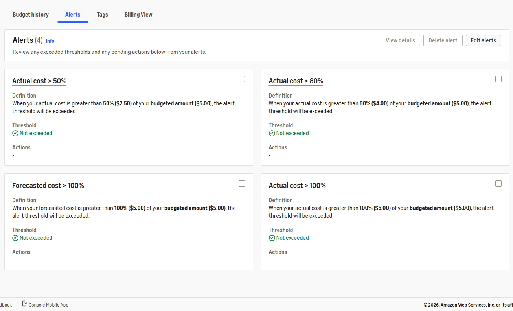

# SW-003 evidence

Output of `tools/verify-account.sh` with profile `stratus`. The script masks the account ID.

```text
Stratus Works · verify-account · profile 'stratus' · 2026-11-14 20:33 TST

[1] Who am I
        account ****9552 · arn:aws:sts::****9552:assumed-role/AWSReservedSSO_AdministratorAccess_609425b036634bcc/sabin-admin
  PASS  Signed in through IAM Identity Center (AWSReservedSSO role)
  PASS  Profile uses SSO (sso settings in ~/.aws/config)
  PASS  Default region is ap-northeast-1
  PASS  No long-lived access keys on this machine

[2] Root user
  PASS  Root MFA enabled (AccountMFAEnabled=1)
  PASS  Root has no access keys (AccountAccessKeysPresent=0)

[3] IAM user access keys
        IAM users: sabin	SabinAdmin
  PASS  No active IAM user access keys

[4] Budgets
        budget: cloud-career-hq-monthly · COST · MONTHLY · 0.01 USD
        budget: stratus-monthly-5usd · COST · MONTHLY · 5.0 USD
  PASS  Monthly cost budget of 5 USD or less (stratus-monthly-5usd)
        alerts on 'stratus-monthly-5usd': ACTUAL:100 ACTUAL:50 ACTUAL:80 FORECASTED:100
  PASS  Alert at 50% ACTUAL
  PASS  Alert at 80% ACTUAL
  PASS  Alert at 100% ACTUAL
  PASS  Alert at 100% FORECASTED
  PASS  Zero-spend budget (cloud-career-hq-monthly)

[5] Cost Anomaly Detection
  PASS  Anomaly monitor exists (1)
  PASS  Anomaly alerts go to an email address

Result: 15 passed, 0 failed
```

## Budget alerts


