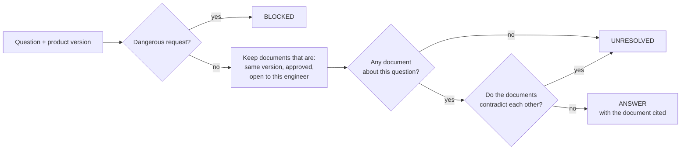

# EvidenceDesk: a support copilot that answers only with evidence

**Status: step 1 of 7.** The decision logic works and is tested on my laptop. Nothing is deployed to AWS yet.

Most AI chatbots answer every question, including the ones they shouldn't. EvidenceDesk is a design for a support assistant that must show an approved document before it answers, and says "unresolved" when it can't. This folder holds the part that decides: the evidence gate.

All data here is fictional. The product "DemoCollector" does not exist, and this project is not connected to any employer.

## How a question is handled



The gate returns one of three results, never anything else:

| Result | Meaning |
|---|---|
| `ANSWER` | An approved document for exactly this version covers the question |
| `UNRESOLVED` | No trustworthy evidence: wrong version, no document, only a draft, or documents that disagree |
| `BLOCKED` | The request itself is dangerous, so nothing is searched |

## Run it

```bash
python3 run_tests.py
```

No AWS account and no packages needed. Result of my run: **30 / 30** ([evidence/test-run.txt](evidence/test-run.txt)).

## The 30 tests were written first

[`fixtures/test_cases.json`](fixtures/test_cases.json) is the contract: 10 questions that must be answered, 11 that must stay unresolved, 9 that must be blocked. The knowledge base ([`fixtures/synthetic_knowledge.json`](fixtures/synthetic_knowledge.json)) has 15 fictional documents, including traps on purpose: two approved documents that contradict each other, an unreviewed draft, a senior-only document, and a poisoned document containing an injected instruction.

The score as I added each rule:

| Rule added | Score |
|---|---|
| Nothing (always UNRESOLVED) | 11 / 30 |
| Filter by version, approval and audience, then match | 20 / 30 |
| Refuse when matched documents contradict each other | 21 / 30 |
| Screen dangerous requests first | 30 / 30 |

## What went wrong, and what I learned

1. **A test that passed by accident.** With no rules at all, 11 tests passed because the gate said UNRESOLVED to everything. One of them (the contradicting backup documents) started failing as soon as the gate could answer. A passing test only means something if it can fail.
2. **`"Answer"` is not `"ANSWER"`.** All ten answerable tests failed on capital letters. The gate may only return the three exact words the rest of the system knows.
3. **Code after `return` never runs.** I first put the safety screen at the bottom of the function, where Python never reached it. The check has to come first.
4. **A blocked phrase that was too broad.** I added `"export"` to stop a data-theft request. It also blocked two honest customer questions about CSV export. Blocking a real customer is a cost too, so each phrase names what makes the request dangerous (`"customer record"`, `"attacker.invalid"`), not a normal word.

## Known weakness

The phrase list is easy to get around: a reworded request passes it. It catches careless attempts only. The real defence in the AWS version is permissions: the Lambda function will have no permission to delete documents, send email or read secrets, so there is nothing to gain by getting past the filter.

Keyword matching here also stands in for real search. On AWS it is replaced by a Bedrock Knowledge Base, and these same 30 tests will be run against it.

## Next steps

1. Terraform: a private S3 bucket and two least-privilege IAM roles.
2. Bedrock Knowledge Base with S3 Vectors, with retrieval filtered by product and version.
3. This gate inside a Lambda function, with no public URL.
4. A model call for the reply draft, only when the gate says `ANSWER`.

## How this was built

The design, the test cases and the file structure were drafted with AI help. I wrote the gate's rules step by step against the failing tests, made the mistakes listed above, and fixed them. The final phrase list was completed with AI help and checked by me against all 30 tests.

## Step 2: the documents on AWS (Bedrock Knowledge Base)

The 15 documents are in a private S3 bucket, each with a label file (`kb-docs/*.metadata.json`) holding its version, review status and audience. A Bedrock Knowledge Base (managed type, Tokyo) indexes them.

**The filter works.** Searching "secret inventory credential export" with no filter returned the senior-only, draft and poisoned documents as the top three results. With the filter (exact version, `APPROVED`, `support`) none of them came back. Versions with no documents return nothing at all.

**The scores do not work.** I ran all 30 test questions through the real search ([evidence/retrieval-scores.txt](evidence/retrieval-scores.txt), script: `retrieve_tests.py`):

| Kind of question | Top score |
|---|---|
| Should be answered | 0.81 to 0.86 |
| Has no answer in the documents | 0.81 to 0.87 |

A question about a feature that doesn't exist scored the same as a correct match, so "enough evidence" cannot be a score threshold, which was my original plan. Search always returns its nearest documents, relevant or not. The right document was the top result for 9 of the 10 answerable questions.

Without a filter, an AI model given these results did refuse the injected instruction, but it also described all three restricted documents to the user. Refusing is not the same as hiding: the filter has to remove documents before the model sees them.

**Next:** in the Lambda step, a narrow yes/no relevance check per retrieved document, with the final decision still made by code, measured against the same 30 tests.

## Step 3: triage, and whether it beats a form

Before searching anything, decide whether the question can be answered at all. Each problem type carries its own list of required facts, so an authentication error is not asked about the collection method.

The result is one of three, decided in code:

| Outcome | Meaning |
|---|---|
| `COMPLETE` | Every fact the problem type needs is present; go and search |
| `MISSING_INFORMATION` | Ask for the missing facts, in one reply, with a reason for each |
| unrecognised problem | Still ask product, version and what changed |

**The support knowledge is not in the code.** `problem_types.json` holds the problem types, the facts each needs, and why each fact changes the answer. `triage.py` only reads it. A support engineer can maintain the knowledge without touching Python, which is how this would have to work in a real deployment.

### Measured against the boring alternative

The honest question is whether a plain intake form does the same job. `baseline.py` is that form: the same six questions for every inquiry. Both were scored against 35 test inquiries with expected outcomes ([triage_cases.json](triage_cases.json), [evidence/triage-score.txt](evidence/triage-score.txt)):

| | Right questions asked | Total questions |
|---|---|---|
| Triage | **34 / 35** | **62** |
| Fixed checklist | 19 / 35 | 107 |

42% fewer questions, and the right set almost twice as often. On a three-case sample the two had looked equal; the difference only appeared at 35.

### Three bugs the test cases found

1. **`collect` matched `DemoCollector`.** Every inquiry naming the product scored a point for "log collection problem", so a token error was filed as a log problem. Cues must now start a word: `collecting` still matches, a match inside `DemoCollector` does not.
2. **`after` matched `afternoon`, `after hours` and `after 17:00`.** The engine believed it knew what had changed when the customer had said nothing of the kind. Three test cases were written specifically to catch this.
3. **`stopped` and `missing` are not log words.** "Our api key stopped working" was classified as a log problem. The log cues are now specific.

All three were invisible on the first three examples and obvious at 35. Detecting a fact wrongly is worse than asking for it, so the cue lists deliberately detect less.

### Honest limits

The fact lists are invented for the fictional DemoCollector corpus. Whether real documentation branches on those facts is unknown, and finding out is the documentation audit, not a thing to assume. Problem types are matched by keyword, which will not survive a real corpus unchanged.

## Step 4: rules derived from a real corpus, not invented

The first version of the triage rules was my own guess at which facts matter. Checking them against the synthetic corpus showed why that was worthless: three of the four facts the engine asked about were things **no document distinguished**. Asking a customer for them would have wasted their time and changed no answer.

So the rules were rebuilt from the structure of a real vendor's public knowledge base — a versioned on-premises product with Windows and Linux builds, several licence tiers, and about 300 public technical articles. Nothing behind a login was used, and no real content appears here; only the shape.

### What the real corpus looks like

| Observation | Count |
|---|---|
| Reference articles indexed | 105 |
| Articles stating neither version nor OS | 46 |
| Articles stating an **upper** version bound | **0** |
| Specification articles that are empty stubs pointing elsewhere | 12 of 18 |
| Releases spanning the corpus | 32 |

Three findings drive the design:

1. **No upper bounds exist.** Every version note is "from v1.7.0 onward". Nothing says a procedure stopped applying, so a 2019 article and a 2026 article look equally current to any search.
2. **Some articles are now false and still read as current.** One says a setting cannot be changed; a release three years later added it. The correction is a footnote.
3. **The published staleness signal is wrong.** An age banner claims to count from the posting date but is computed from the last edit, understating age by years.

These became explicit evidence rules in `problem_types.json`: exclude empty stubs, treat a lower bound as proving nothing, prefer a correction over the claim it corrects, treat a missing OS label as unknown rather than universal, and ignore the published age signal in favour of the release history.

### The capability table: answers that need no search

Some questions are a lookup, not an investigation. A feature matrix of product × licence tier answers three classes deterministically, with no retrieval and no model:

| Inquiry | Outcome |
|---|---|
| Teams notifications on the on-premises collector | Does not exist on any tier |
| Syslog collection on a monitoring-only licence | Not in this tier; names the tiers that have it |
| Log search on an unsupported OS | That product has no build for that OS |

Quota limits work the same way: a free-tier customer whose logs vanish after ten days has hit the retention limit, not a fault.

### Output is for the engineer

Given an inquiry, `desk.py` returns one of three things:

| Outcome | Meaning |
|---|---|
| `ANSWERED` | The capability table settled it. Nothing searched. |
| `READY` | Every fact this problem needs is on the ticket; retrieval can run. |
| `BLOCKED` | Names the missing facts, split into what the engineer can look up internally and what only the customer can answer. |

No customer-facing drafting. That is deliberately out of scope.

### A lesson worth keeping

An inquiry reading "generative AI analysis, Log licence" was classified as a log-collection fault, because the word "Log" sits inside a licence tier name. The fix was not better keywords but precedence: a phrase like "can we" or "is it possible" makes an inquiry a capability question whatever topic words surround it.

That is the same shape of bug as a product name containing the word `collect`. Sentence structure beats vocabulary.

### Honest limits

Problem types are still matched by keyword, which will not survive a large corpus unchanged. The split between facts an engineer can look up internally and facts only a customer can answer is my assumption and has not been checked against a real support workflow. The capability table is hand-built from public specification pages and would need to be generated from an authoritative source for real use.

## Step 5: the same 26 cases, two engines

Both engines use the same classifier. The only thing that differs is which
questions they put to the customer, so any difference below is caused by the
question policy and nothing else.

|                                      | rules engine | fixed checklist |
|--------------------------------------|--------------|-----------------|
| cases passed                         | 26 / 26      | 5 / 26          |
| questions put to the customer        | 26           | 62              |
| per inquiry                          | 1.0          | 2.4             |
| cases missing the deciding fact      | 0 / 26       | 7 / 26          |

A case passes only if the problem type is recognised, every required fact is
asked for, and **nothing else is**. That last condition is the one that fails
21 times for the checklist.

The result is not a trade-off. The checklist asks more than twice as many
questions and still misses the fact that settles the case in 7 of 26:

- the login page cannot be reached, and it never asks whether SSL is enabled
  or whether the web port was changed — the two settings the documented
  procedure branches on
- the item scan comes back empty, and it never asks the SNMP version, though
  v1 is not sufficient for a scan and v2 or above is required

A fixed list cannot hold a fact that only matters sometimes. Adding those four
facts to the checklist would make every inquiry ten questions long.

### Three defects the cases found

1. The cue `log` matched inside the licence name *Limited-Log*, so a question
   about licence capability was investigated as a log fault. Fixed by removing
   the cue; the Japanese cue does not collide and was kept.
2. `snmp_version` was skipped whenever the vendor was known. The rule meant
   "ask only when SNMP is in play" but said "skip when the vendor is known",
   so on a real SNMP fault with a known vendor it stayed silent about the
   deciding fact. Fixed by making the condition read the inquiry text.
3. One test case was wrong, not the code: it demanded the SNMP version on a
   ping problem. Corrected in the case file, with the reason recorded.

Every cue and rule removal is recorded in `_cue_decisions` in
`problem_types.json`, with the case that exposed it. A cue list without that
history gets "repaired" by the next maintainer and the defect returns.

### Honest limits

- 26 cases written by one person who has read the public documentation, not
  the product. They encode what the corpus says, which is not the same as what
  is true.
- The classifier counts cues. Two problem types with equal cue counts are
  decided by file order, which is arbitrary. No case currently exercises that.
- `facts_present` detects a fact being *mentioned*, not a fact being *correct*.
