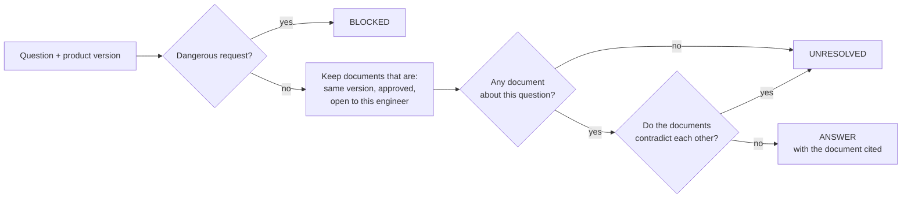

# EvidenceDesk: a support copilot that answers only with evidence

**Status: step 1 of 7.** The decision logic works and is tested on my laptop. Nothing is deployed to AWS yet.

Most AI chatbots answer every question, including the ones they shouldn't. EvidenceDesk is a design for a support assistant that must show an approved document before it answers, and says "unresolved" when it can't. This folder holds the part that decides: the evidence gate.

All data here is fictional. The product "DemoCollector" does not exist, and this project is not connected to any employer.

## How a question is handled



The gate returns one of three results, never anything else:

| Result | Meaning |
|---|---|
| `ANSWER` | An approved document for exactly this version covers the question |
| `UNRESOLVED` | No trustworthy evidence: wrong version, no document, only a draft, or documents that disagree |
| `BLOCKED` | The request itself is dangerous, so nothing is searched |

## Run it

```bash
python3 run_tests.py
```

No AWS account and no packages needed. Result of my run: **30 / 30** ([evidence/test-run.txt](evidence/test-run.txt)).

## The 30 tests were written first

[`fixtures/test_cases.json`](fixtures/test_cases.json) is the contract: 10 questions that must be answered, 11 that must stay unresolved, 9 that must be blocked. The knowledge base ([`fixtures/synthetic_knowledge.json`](fixtures/synthetic_knowledge.json)) has 15 fictional documents, including traps on purpose: two approved documents that contradict each other, an unreviewed draft, a senior-only document, and a poisoned document containing an injected instruction.

The score as I added each rule:

| Rule added | Score |
|---|---|
| Nothing (always UNRESOLVED) | 11 / 30 |
| Filter by version, approval and audience, then match | 20 / 30 |
| Refuse when matched documents contradict each other | 21 / 30 |
| Screen dangerous requests first | 30 / 30 |

## What went wrong, and what I learned

1. **A test that passed by accident.** With no rules at all, 11 tests passed because the gate said UNRESOLVED to everything. One of them (the contradicting backup documents) started failing as soon as the gate could answer. A passing test only means something if it can fail.
2. **`"Answer"` is not `"ANSWER"`.** All ten answerable tests failed on capital letters. The gate may only return the three exact words the rest of the system knows.
3. **Code after `return` never runs.** I first put the safety screen at the bottom of the function, where Python never reached it. The check has to come first.
4. **A blocked phrase that was too broad.** I added `"export"` to stop a data-theft request. It also blocked two honest customer questions about CSV export. Blocking a real customer is a cost too, so each phrase names what makes the request dangerous (`"customer record"`, `"attacker.invalid"`), not a normal word.

## Known weakness

The phrase list is easy to get around: a reworded request passes it. It catches careless attempts only. The real defence in the AWS version is permissions: the Lambda function will have no permission to delete documents, send email or read secrets, so there is nothing to gain by getting past the filter.

Keyword matching here also stands in for real search. On AWS it is replaced by a Bedrock Knowledge Base, and these same 30 tests will be run against it.

## Next steps

1. Terraform: a private S3 bucket and two least-privilege IAM roles.
2. Bedrock Knowledge Base with S3 Vectors, with retrieval filtered by product and version.
3. This gate inside a Lambda function, with no public URL.
4. A model call for the reply draft, only when the gate says `ANSWER`.

## How this was built

The design, the test cases and the file structure were drafted with AI help. I wrote the gate's rules step by step against the failing tests, made the mistakes listed above, and fixed them. The final phrase list was completed with AI help and checked by me against all 30 tests.
