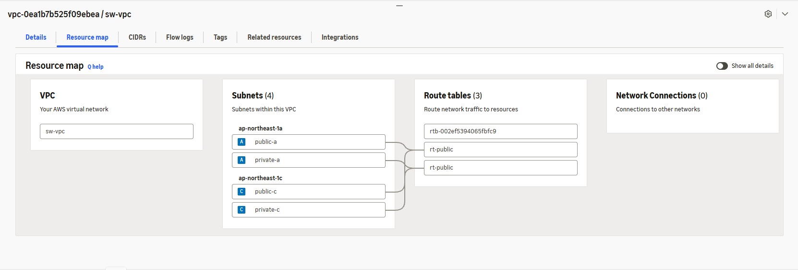

# A 2-AZ VPC built by hand (SW-101)

Our own network in Tokyo, built in the console and then proven from the CLI: two public and two private subnets across two Availability Zones.



## Design
| Subnet | AZ | CIDR | Route table | Internet |
|---|---|---|---|---|
| public-a | ap-northeast-1a | 10.20.0.0/24 | public: `0.0.0.0/0 → internet gateway` | yes |
| public-c | ap-northeast-1c | 10.20.1.0/24 | public: `0.0.0.0/0 → internet gateway` | yes |
| private-a | ap-northeast-1a | 10.20.10.0/24 | private: local route only | no |
| private-c | ap-northeast-1c | 10.20.11.0/24 | private: local route only | no |

VPC: `10.20.0.0/16` (65,536 addresses), one internet gateway attached.

**Why two AZs.** An Availability Zone is one or more separate data centres. If one has a problem, the subnets in the other keep working. A load balancer and a Multi-AZ database both need subnets in at least two AZs.

**Why private subnets.** Databases and application servers never need to be reached from the internet. With no route to the internet gateway, they can't be, even if a security group is opened by mistake. Only things the internet must reach (a load balancer) go in public subnets.

**Why these CIDRs.** Public subnets use 10.20.0–9, private use 10.20.10–19, so the third number tells you the tier at a glance, and each tier has room for more AZs.

## Subnet maths
A `/24` has 2^(32−24) = 256 addresses. AWS reserves 5 in every subnet, so **251 are usable**. For 10.20.0.0/24:

| Address | Reserved for |
|---|---|
| 10.20.0.0 | network address |
| 10.20.0.1 | VPC router |
| 10.20.0.2 | DNS |
| 10.20.0.3 | future use |
| 10.20.0.255 | broadcast (not supported in a VPC, still reserved) |

## Proof: `tools/vpc-check`
[`tools/vpc-check`](../../tools/vpc-check) reads each subnet's route table and prints PUBLIC only if it has a route to an internet gateway.

```text
VPC vpc-0ea1b7b525f09ebea
PUBLIC   public-a    ap-northeast-1a  10.20.0.0/24    igw-0d95386c42fe1501c
PRIVATE  private-a   ap-northeast-1a  10.20.10.0/24   no internet route
PUBLIC   public-c    ap-northeast-1c  10.20.1.0/24    igw-0d95386c42fe1501c
PRIVATE  private-c   ap-northeast-1c  10.20.11.0/24   no internet route
```
Raw route tables: [evidence/3-route-tables.json](evidence/3-route-tables.json).

## What went wrong: "public" was only a name
My first run said all four subnets were PRIVATE ([evidence/1-before-no-igw-route.txt](evidence/1-before-no-igw-route.txt)). I thought the tool was broken. It wasn't: the subnets were associated with the right route tables, but no table had a `0.0.0.0/0 → igw` route yet. The fix was one route in the public route table.

Lesson: a subnet is not public because of its name or its AZ. It is public only when its route table sends `0.0.0.0/0` to an internet gateway. Check the route table, not the label.

## Cost
A VPC, subnets, route tables and an internet gateway cost nothing. The expensive part would be a NAT gateway (about 0.06 USD per hour, even idle), and none is running: `cost-check` reports 0 billable resources ([evidence/4-cost-check.txt](evidence/4-cost-check.txt)).

## How it was built
Built by hand in the AWS console, then verified from the CLI. README drafted with AI help from my own command output.
